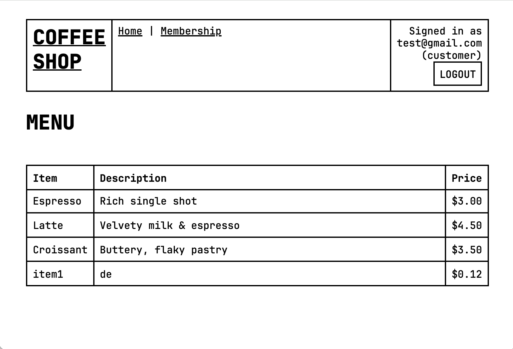
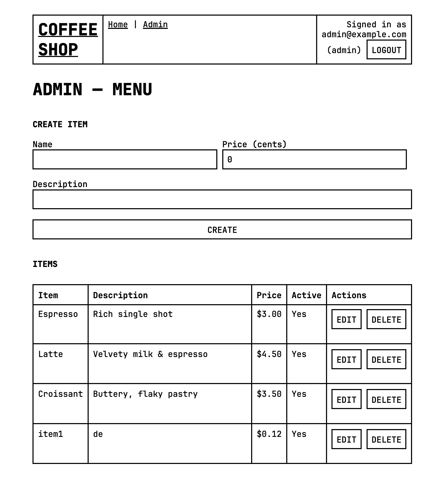

# ☕ Cafe Web App

A simple **Cafe web application** built with **Vue.js** on the frontend and **Gin** (Golang) on the backend.
This project is created for learning and practicing these two frameworks.

---

## 🖼️ Screenshots
homepage

admin page


## 🚀 Features

- [x] Homepage with menu displayed
- [x] Two types of logins: admin & member
- [x] Admin page to add/ remove/ edit menu items
- [ ] Membership details
- [ ] Order management with real-time updates

---
## ⚙️ How to run

```
cd client
npm run build

cd server
go run .
```
